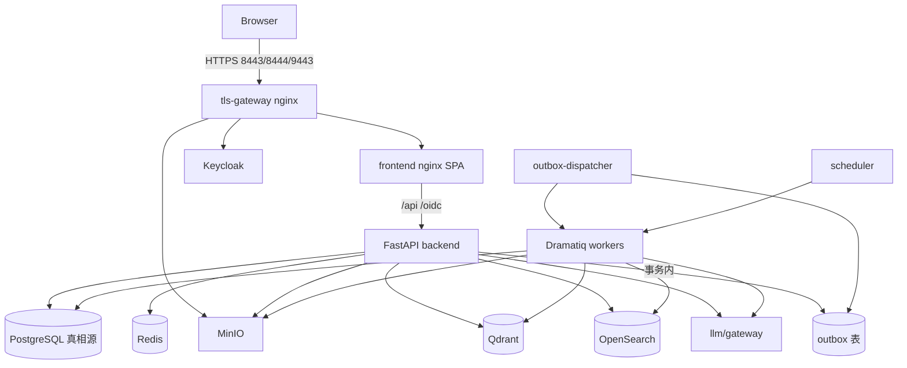

# 生产就绪审计报告（第一阶段）

> 审计日期：2026-10-20  
> 范围：工作区真实源码、迁移、测试、部署配置；**不以 README/汇报文案作为完成证据**。  
> 证据标注：`implemented+tests` | `implemented-no-tests` | `partial` | `missing` | `defect` | `unverifiable`

---

## 0. 结论摘要

| 维度 | 成熟度 | 说明 |
| --- | --- | --- |
| 架构分层 / Outbox / 双路检索 + PG 二次 ACL | 高 | 主路径清晰，测试覆盖较好 |
| 权限（站内检索/问答/文档 API / Open API） | 中高 | 服务端强制；签名 URL 与流式中途撤销有窗口 |
| 文档业务生命周期（草稿→废止） | **低** | 仅有入库状态机；`effective_*` 不参与检索过滤（缺陷） |
| 数据分类 / 外发模型策略 | 低 | 有防护字段与可选 PII，无密级模型 |
| 灾备与告警闭环 | 中 | 有日备脚本与手册；Alertmanager + server observability profile + 备份 textfile 告警已落地；仍无 PITR / 异地强制 / 演练签字 |
| RAG 质控与评测平台 | 中高 | 拒答/引用/RRF 有测；金标门禁（`pytest -m gold`）与多语 BM25 子字段已落地，生产需 rebuild |

**生产试运行建议**：可在受控内网试运行（单一组织、人工运维），但进入多工厂 / 正式制度库前须完成下文 **P0** 项。

### 本阶段已落地的修复（相对初审）

| ID | 修复 | 位置 |
| --- | --- | --- |
| D1 | 文档生效窗口 + lifecycle 进入 `PassageHydrator` | `document_effect.py`, `hydrator.py` |
| D2 | 水印页签名访问重验文档 ACL | `page_links.render_watermarked_page`, `api/v1/assets.py` |
| D3 | 文档删除 bump 检索缓存 | `indexing/handlers.on_document_deleted` |
| P0-2 | `lifecycle_status` / 状态机 API / 前端操作 | 迁移 `0021`, `POST .../lifecycle`, DocumentDetailView |
| P0-3 | `classification`；Open API 对 confidential+ 截断导出 | 模型 + `open_service.py` |
| P0-4 | RPO/RTO 诚实文档；Alertmanager + server 观测 profile；备份失败可观测 | `backup-recovery.md`；`deploy/observability`；`prod.server.yml` profile |

---

## 1. 真实架构（源码）

| 数据流 | 关键路径 | 状态 |
| --- | --- | --- |
| 认证 | Keycloak OIDC → JWT/JWKS（`api/deps.py`） | `implemented+tests` |
| 授权 | RBAC `require_permission` + `KnowledgeAccess` / `AclService` | `implemented+tests` |
| 入库 | upload MinIO+PG → worker parse/chunk → Outbox → index | `implemented+tests` |
| 检索 | Dense∥Sparse → RRF → `PassageHydrator` PG ACL | `implemented+tests` |
| 问答 | AnswerService + EvidenceAclChecker + CitationValidator | `implemented+tests` |
| Open/MCP | ApiKey → 非超管服务身份 ∩ `allowed_kb_ids` | `implemented+tests` |
| 管理助手 | TaskSpec 模板 + preview/risk/approval + 原 service | `implemented+tests` |

**职责问题（非阻塞）**：`DocumentStatus` 命名易与业务「发布状态」混淆；删除不 bump 检索缓存代次（正确性靠 hydrate）；`tls-gateway` 曾因 DNS 缓存导致 502（已修动态解析）。

---

## 2. 能力盘点（抽样证据）

### 2.1 已实现且有测试

| 能力 | 证据 |
| --- | --- |
| ACL 语义 / 部门祖先 | `services/authz/acl.py`, `principals.py`；`tests/test_acl_service.py` |
| 搜索 ACL | `test_search_acl.py`, `test_acl_regression.py` |
| 文档保护 / 受控导出 | `protection.py`, `test_document_protection.py` |
| 版本历史与恢复 | `document_service.restore_version`, `test_document_versions.py` |
| 负责人 / 复核提醒 | `review.py`, `test_document_review.py` |
| 收藏评论 Markdown | `services/collab/*`, `test_collab.py` |
| Outbox 死信 / 重建蓝绿 | `indexing/outbox.py`, `rebuild.py`, `test_indexing.py` |
| 评测指标 Recall/MRR/nDCG + judge | `evaluation/metrics.py`, `test_evaluation.py` |
| Gap→KO 闭环 | `test_curation.py` |
| Open API Key 吊销/过期/IP/配额 | `test_open_api.py` |
| Chat fallback（首 token 前） | `llm/gateway.py`, `test_llm_gateway.py` |
| 限流 / file_guard / retention | `test_security.py`, `test_retention.py` |
| Prometheus metrics | `core/metrics.py`, `test_observability.py` |

### 2.2 已实现但缺关键测试 / 部分实现

| 能力 | 缺口 |
| --- | --- |
| `preview-text` | 有 `_doc(READ)`，缺 ACL 回归用例 |
| API Key 轮换 | create+revoke，无单接口 rotate |
| Chat 流式中途撤销权限 | Evidence ACL 仅生成前一次 |
| 多语种 BM25 | IK 主字段 + `.en`/`.vi` multi-field（越文暂用 standard；需全量 rebuild） |
| Embedding/Rerank failover | 无第二端点；rerank 可 degrade |
| Rebuild HTTP API | 仅 CLI |
| Server 部署观测 | `prod.server.yml` 已含 `--profile observability`（Prometheus / Alertmanager / Grafana） |
| PII 脱敏 | 实现完整，默认关闭 |

### 2.3 缺陷

| ID | 问题 | 证据 |
| --- | --- | --- |
| D1 | 文档 `effective_from`/`effective_to` **不参与**检索/问答 hydrate；过期文档仍可作答 | `hydrator.py` vs `ko_access.in_effect` |
| D2 | 水印页签名 URL 验签后**不重验**文档 ACL；撤销后 TTL 内仍可读 | `page_links.render_watermarked_page` |
| D3 | 文档删除不 `invalidate_org` 检索缓存 | `handlers.on_document_deleted` |
| D4 |（已修）`realm-ekb.prod.json` 尾逗号导致 Keycloak unhealthy | 历史提交 |
| D5 |（已修）tls-gateway 缓存上游 IP → 502 | `tls-gateway.conf` |

### 2.4 尚未实现（相对任务书）

| 能力 | 说明 |
| --- | --- |
| 文档业务状态机 draft→archived | 仅有入库 `DocumentStatus`；KO 另有 `KoStatus` |
| 文档密级 / 分类 ABAC | 无 classification 字段 |
| 显式 ACL DENY | 仅 allow-list |
| 索引任务 PARSING 僵尸 watchdog | 崩溃后可永久卡住 |
| 软删后 MinIO/chunk 物理清理 | `RETENTION_DELETED_DOCUMENT_DAYS`（默认 30）日批清理对象与 chunk；可选硬删行 |
| Alertmanager 告警投递 | `--profile observability` 含 Alertmanager；需配置 `ALERTMANAGER_WEBHOOK_URL` |
| PITR / 异地备份自动化 | 文档建议未落地；日 dump ≈ RPO 24h |

---

## 3. 权限专项（摘要）

详见 [`permission-security-matrix.md`](./permission-security-matrix.md)。

统一入口：`KnowledgeAccess` + 检索 `AclFilter` + hydrate。前端 `v-permission` / 路由 `meta.permission` **仅 UX**。Open API **无超管旁路**（`open_api/auth.py`）。

残留风险：D2 签名窗口、流式生成窗口、默认无 DENY。

---

## 4. 数据一致性（摘要）

| 场景 | 状态 |
| --- | --- |
| Parse 失败 → FAILED + 可 reprocess | `implemented+tests` |
| Outbox 幂等 / 死信 | `implemented+tests` |
| 删文档清 Qdrant/OS | `implemented+tests` |
| 删文档清缓存 | `partial`（D3） |
| PARSING 僵尸 reclaim | `missing` |
| 蓝绿重建 + CLI 回滚 | `implemented+tests` |

---

## 5. RAG（摘要）

拒答、引用剥离、RRF、父子扩展、证据闸门：`implemented+tests`。  
阈值来自配置，**未见**按模型标定的评测校准记录 → 阈值正确性 `unverifiable`。  
过期制度仍可能被召回：**defect D1**。

---

## 6. 生产运维（摘要）

| 项 | 状态 |
| --- | --- |
| TLS 网关 / compose | `implemented-no-tests`；server 默认 `0.0.0.0` 暴露面偏大 |
| 日备 PG+MinIO | `implemented-no-tests`；有效 RPO≈24h |
| 指标 | `implemented+tests`；Alertmanager webhook 通道已接好（需配置 URL） |
| OpenSearch 关安全插件 | 内网风险 `defect` |
| 备份演练 | 手册有，无演练记录 → `unverifiable` |

---

## 7. 优先级路线图

### P0（本阶段必须推进）

1. **P0-1** 签名页资产 ACL 重验；删除 bump 检索缓存；补 preview-text / 撤销窗口测试说明  
2. **P0-2** 文档生效窗口进入 hydrate；引入兼容的 `lifecycle_status`（存量默认 published）与状态机  
3. **P0-3** `classification` + 外发/导出策略钩子；日志敏感字段审查说明  
4. **P0-4** 固化 RPO/RTO 与恢复验证文档；Alertmanager + server 观测 profile + 备份 textfile 告警（收尾已落地；PITR/演练仍属运维待办）  

### P1

Gap 分派 SLA、评测金标门禁、多语种分析器、僵尸任务 watchdog、对象清理——**本批已落地代码与单测**；生产需 OpenSearch 全量 rebuild + 确认 retention 配置。

### P2

多工厂隔离评估、Wiki 协同、HA 改造评估。

---

## 8. 无法验证事项

- 生产环境实际备份是否异地、是否演练成功。  
- 线上模型真实拒答率 / 召回率（仅有仓库内评测与汇报数据）。  
- Worker 主机网络隔离是否阻止直连索引。  
- ClamAV / PII 在生产是否开启。

---

## 9. 审计方法

并行只读审查：`services/authz`、`knowledge`、`indexing`、`retrieval`、`chat`、`open_api`、`deploy/`、`docs/ops/`、`backend/tests`（约 49 文件 / ~369 用例）、前端 vitest（约 27 文件）。未以 mock 替代业务断言结论；本报告不声称「已跑通全量 pytest」——执行结果见后续 `docs/testing/production-acceptance-report.md`。
